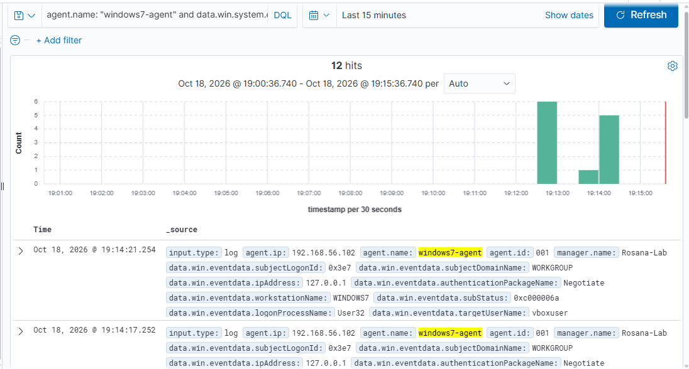
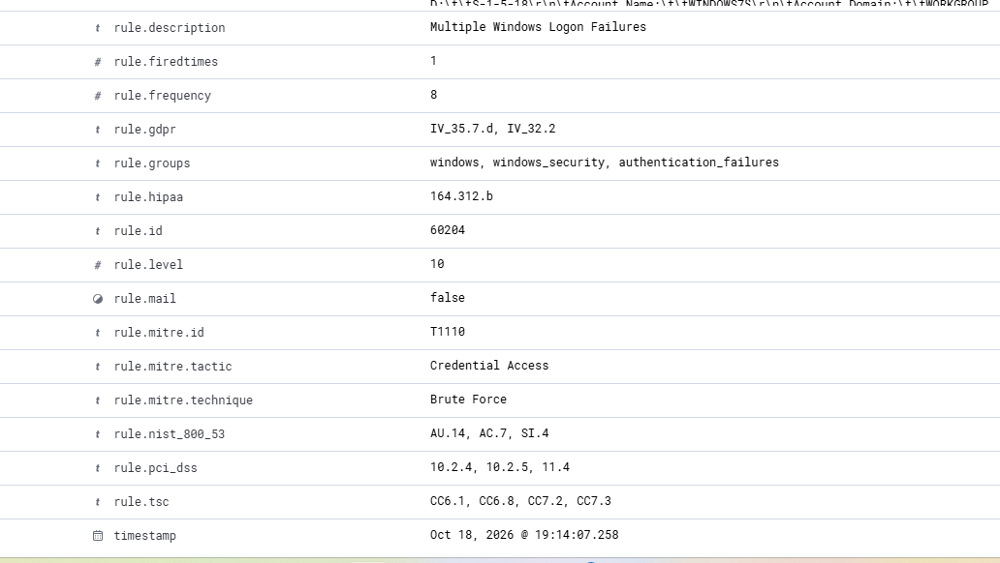
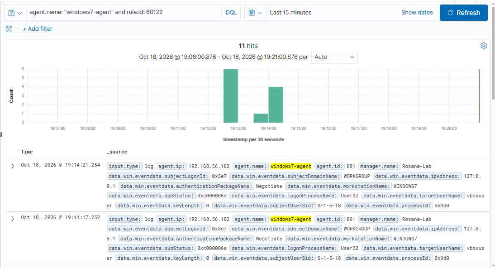
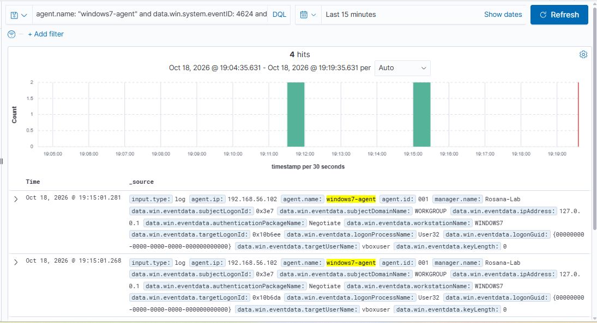

# Incidente simulado 02 — Múltiplas falhas de logon seguidas de logon com sucesso (Windows 7)

> Evento gerado de propósito no laboratório (`blue-team-lab/`) para praticar detecção e investigação com o Wazuh. Nenhum sistema real foi afetado. Este incidente é a continuação do [incidente 01](../01-logon-failure-windows7), com volume maior de tentativas.

## Resumo

| Campo | Valor |
|---|---|
| Data | 18/10/2026 |
| Janela das falhas | de ~19:12:49 a 19:14:21 (cerca de 1 min 30 s) |
| Severidade máxima (Wazuh) | **Nível 10** (regra 60204) |
| Host afetado | `windows7-agent` (ID 001, IP 192.168.56.102) |
| Conta alvo | `vboxuser` |
| Origem | `127.0.0.1` (a própria máquina), login interativo |
| Tipo | 12 falhas de autenticação, seguidas de logon com sucesso |
| Classificação final | Atividade esperada do laboratório (simulação) |

## Linha do tempo

| Horário | Evento |
|---|---|
| ~19:12:49 a 19:12:55 | Primeiro bloco de falhas, uma a cada ~2 s (o gráfico do Discover mostra 6 falhas nessa janela de 30 s) |
| ~19:13:33 | 1 falha isolada (pausa no teste) |
| **19:14:07** | **8ª falha: o Wazuh dispara a regra de correlação 60204, "Multiple Windows Logon Failures" (nível 10)** |
| 19:14:11 a 19:14:21 | 4 falhas finais, a cada 2 a 4 s (19:14:11, :13, :17, :21) |
| **19:15:01** | **Logon com sucesso** de `vboxuser`, cerca de 40 s depois da última falha |

## Evidências

Buscas feitas no Discover (período: últimos 15 minutos):

| Busca (DQL) | Resultado |
|---|---|
| `agent.name: "windows7-agent" and data.win.system.eventID: 4625` | 12 eventos |
| `agent.name: "windows7-agent" and rule.id: 60122` | 11 eventos (falhas individuais, nível 5) |
| `agent.name: "windows7-agent" and rule.level >= 8` | 2 eventos (1 é o alerta 60204; o outro é ruído, ver abaixo) |
| `agent.name: "windows7-agent" and data.win.system.eventID: 4624 and data.win.eventdata.logonType: 2` | 4 logons interativos (2 anteriores ao teste e 2 às 19:15:01) |

Os 12 eventos 4625 são 11 alertados pela regra 60122 mais o 8º, que foi alertado pela regra de correlação 60204. Isso é consistente com `rule.frequency: 8`: 7 falhas anteriores + a que completou a contagem.

Campos do alerta de correlação:

- `rule.id: 60204`, "Multiple Windows Logon Failures"
- `rule.level: 10`
- `rule.frequency: 8`
- `rule.firedtimes: 1`
- `rule.groups: windows, windows_security, authentication_failures`
- `rule.mitre.id: T1110`, `rule.mitre.technique: Brute Force`, `rule.mitre.tactic: Credential Access`
- `rule.pci_dss: 10.2.4, 10.2.5, 11.4`, `rule.nist_800_53: AU.14, AC.7, SI.4`

Campos comuns às falhas individuais:

- `data.win.eventdata.subStatus: 0xc000006a` (usuário existe, senha errada)
- `data.win.eventdata.targetUserName: vboxuser`
- `data.win.eventdata.logonType: 2` (interativo)
- `data.win.eventdata.ipAddress: 127.0.0.1`
- `data.win.eventdata.logonProcessName: User32`

Logon com sucesso (Event ID 4624, 19:15:01):

- `targetUserName: vboxuser`, `ipAddress: 127.0.0.1`, `logonProcessName: User32`
- Dois registros com 13 ms de diferença e `targetLogonId` distintos (`0x10b6da` e `0x10b6ee`)

## Análise

1. **Volume e correlação.** Doze falhas em cerca de 1 min 30 s passaram do limite da regra de correlação (8 falhas), e o SIEM elevou a severidade de 5 para 10. Isso é o que diferencia este incidente do 01: três falhas isoladas são ruído; uma sequência assim já merece atenção.
2. **Usuário válido.** O `subStatus 0xc000006a` em todas as falhas indica que a conta existe e só a senha estava errada. Se fosse tentativa às cegas, seria comum ver também `0xc0000064` (usuário inexistente).
3. **Origem local.** `127.0.0.1` e `logonType 2` indicam alguém digitando na tela de login da própria máquina, e não ataque pela rede.
4. **Ritmo humano, com pausas.** Intervalos de 2 a 4 segundos e uma pausa de cerca de 38 s no meio são típicos de digitação manual. Ferramentas automatizadas tentam várias senhas por segundo, sem pausa.
5. **Falhas seguidas de sucesso.** O padrão "várias falhas e depois acerto" é o que mais preocupa em casos reais, porque pode indicar que a senha foi descoberta. Aqui, o logon veio da mesma origem local, 40 s depois da última falha, e foi gerado de propósito no teste.
6. **Dois registros de logon às 19:15:01.** A diferença de 13 ms e os `targetLogonId` distintos sugerem o par de logons que o Windows costuma registrar para contas com privilégios elevados (token normal e token elevado). Não confirmei isso nos campos; é uma hipótese.

## Mapeamento MITRE ATT&CK

Neste caso o mapeamento do Wazuh, **T1110 — Brute Force** (tática: Credential Access), descreve bem o comportamento: várias tentativas de autenticação falhas em sequência contra uma mesma conta.

Comparação com o incidente 01:

| | Incidente 01 | Incidente 02 |
|---|---|---|
| Falhas | 3 | 12 |
| Regra | 60122 (nível 5) | 60204 (nível 10), além da 60122 |
| MITRE sugerido | T1531 (Account Access Removal) | T1110 (Brute Force) |
| Leitura do analista | Ruído, erro de digitação | Padrão compatível com tentativa de adivinhação de senha |

## Ruído descartado

A busca por nível >= 8 trouxe um segundo evento, às 19:11:26, que não tem relação com o teste: um evento do WMI (filtro de monitoramento de uso de CPU) gerado antes das tentativas de login. Foi descartado como atividade normal do sistema, mas registrado aqui porque em investigação real eventos assim também precisam ser conferidos antes de serem descartados.

## Impacto

Nenhum além do próprio teste. O logon com sucesso foi do usuário legítimo do laboratório.

## Resposta (o que eu faria num cenário real)

- **Aqui:** nenhuma ação, é teste do laboratório.
- **Se o logon com sucesso depois das falhas não fosse esperado:**
  1. Confirmar com o dono da conta se foi ele.
  2. Verificar se a origem foi console local, RDP ou rede (`logonType` e `ipAddress`).
  3. Trocar a senha da conta e encerrar as sessões ativas.
  4. Revisar o que foi feito depois do logon (processos novos, criação de usuários, alterações de política).
  5. Escalar para o nível 2 se houver atividade suspeita.
- **Prevenção:** política de bloqueio de conta após N tentativas e autenticação em dois fatores quando aplicável.

## Lições e limitações da detecção

- A regra 60204 só dispara com 8 falhas dentro da janela de tempo dela. Um atacante que tente poucas senhas por vez ("low and slow") pode ficar abaixo do limite, como aconteceu no incidente 01. A janela de tempo exata não aparece nos campos do alerta; vale conferir a definição da regra no Wazuh (Server management → Rules).
- Como no incidente 01, a detecção só existe porque a auditoria de falhas de logon foi ativada no Windows 7 (`auditpol`). A qualidade do SIEM depende da política de auditoria do endpoint.

## Próximos passos

- Conferir a definição das regras 60122 e 60204 em Server management → Rules (janela de tempo e condições).
- Testar o caso de usuário inexistente (`subStatus 0xc0000064`) e comparar os campos.
- Gerar falhas contra a Windows 7 a partir de outra máquina (Kali, na fase seguinte do laboratório), para observar `logonType` e `ipAddress` de origem remota.
